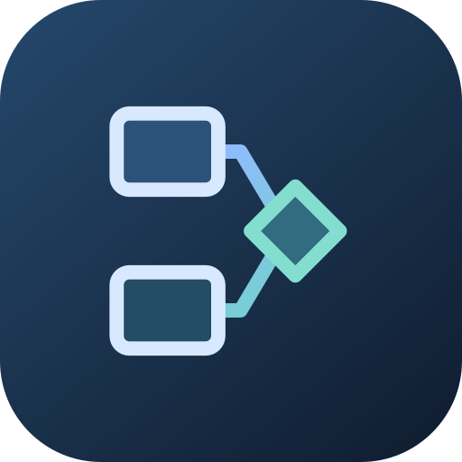
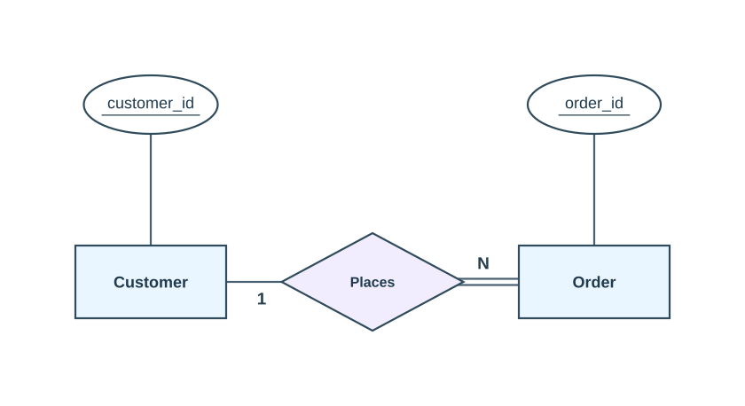

<p align="center">
  
</p>
<h1 align="center">Bosha Studio</h1>
<p align="center"><strong>Design your data. Connect your ideas.</strong></p>
<p align="center">An English-language workspace for creating, organizing, collaborating on, and exporting entity relationship diagrams.</p>
<p align="center">
  <a href="https://bosha-er-studio-5b42.tiny-mole-7191.chatgpt.site">Open the live app</a> ·
  <a href="docs/USER_GUIDE.md">User guide</a> ·
  <a href="docs/DEVELOPMENT.md">Developer setup</a> ·
  <a href="docs/ARCHITECTURE.md">Architecture</a>
</p>

## What you can build

Bosha Studio turns database concepts into editable diagrams. Start from a blank canvas, try a small example, or choose a template. Build in Chen notation, switch to Crow’s Foot, check the model, and export the complete drawing as PNG, SVG, or vector PDF.

Guest diagrams save on the current device. Signed-in users get private account workspaces, cloud autosave, revision history, and controlled sharing. Collaborative diagrams support owner, editor, and viewer roles.



*This is an exported diagram, not a screenshot. The editor connects Customer to Order through Places, with separate cardinality and participation for each entity.*

## Features

| Area | Available today |
| --- | --- |
| Getting started | Focused first-visit Home, blank diagram or editable example, three short steps, optional sign-in, and a welcome screen that can be reopened from Help |
| Dashboard | Diagram cards, recent work, continue editing, search, sorting, notation filters, grid/list views, duplicate, delete with immediate undo |
| Modeling | Entities, weak entities, relationships, identifying relationships, attributes, primary/partial keys, derived, multivalued, and composite attributes |
| Relationship settings | Independent cardinality (`1`, `N`, `M`, or unset), Partial/Total participation, and role labels for each connected entity |
| Canvas | Hold and drag empty space to pan, pointer-centered zoom, fit to screen, grid, snapping, alignment guides, and touch/pointer controls |
| Editing | Names update as you type; Undo/Redo, multiple selection, group move, copy/paste, alignment, and distribution |
| Connected movement | Moving an entity also moves its attached attribute tree; moving an attribute alone leaves the entity in place |
| Lines and layout | Connections render behind shapes; straight/orthogonal routing, draggable bends, and deterministic, undoable auto layout |
| Notation | Chen and Crow’s Foot views share one underlying conceptual model |
| Validation | Locate issues such as missing keys, incomplete relationships, disconnected elements, and shape-crossing connections |
| SQL | PostgreSQL preview, copy, and download, with warnings for assumptions requiring review |
| Export | Whole-diagram PNG/SVG, light/dark export appearance, optional PNG/SVG transparency, vector PDF with embedded fonts, A4/A3, orientation, and tiled pages |
| Accounts | Host-provided ChatGPT sign-in and optional Google sign-in/linking; private projects per account |
| Saving | Device autosave, cloud revision checks, account-specific offline caches, conflict recovery copies, and up to 50 versions per diagram |
| Collaboration | Invitations, editor/viewer permissions, participant cursors/presence, comments, and merging compatible edits |
| Sharing | Read-only links for one diagram, optional expiry, link replacement/revocation, and a dedicated viewer |
| Appearance | Light, Dark, and System themes; export appearance is independent of the app theme |
| Installable app | PWA shell, offline editor assets, installation detection, and user-controlled updates that respect pending edits |
| Templates | Commerce, People & teams, Inventory, Healthcare, Learning platform, and Subscriptions |

Collaboration refreshes while the app is open using polling, approximately every two seconds; it is not a WebSocket/CRDT service. Automatic layout and validation are practical editing aids, not guarantees of perfect layout or complete database correctness.

## Quick start

### Use the hosted app

Open **[Bosha Studio](https://bosha-er-studio-5b42.tiny-mole-7191.chatgpt.site)**. Choose **Create your first diagram** or **Try an example**. You can start without an account. Sign in when you want cloud storage or collaboration.

To reopen the introduction, choose **Help & shortcuts → Getting started**.

### Run the full application locally

Prerequisites: **Node.js 22.13+** and **pnpm 11.25.0**, matching `package.json` and the lockfile.

```bash
git clone https://github.com/R3Dzf/ER_Diagram.git
cd ER_Diagram
pnpm install --frozen-lockfile
pnpm run db:migrate:local
pnpm run dev
```

Open **http://localhost:5173/studio/**. The local D1 database uses ignored `.wrangler/` state. The portable development server includes a loopback-only **mock ChatGPT account**, useful for testing cloud workspace behavior locally; it is not a real ChatGPT login.

Google sign-in requires a Web application client, authorized origin, and the `GOOGLE_CLIENT_ID` runtime binding. See [authentication and deployment](docs/DEPLOYMENT.md).

### Run only the browser editor

The editor also runs as static files, with guest projects saved on the device:

```bash
python -m http.server 8080 --bind 127.0.0.1 --directory public
```

Open **http://localhost:8080/studio/**. Cloud APIs, account login, collaboration, and authenticated sharing require the full backend. A static-only run can report that cloud storage is unavailable and continue as a guest.

## Technology

| Layer | Implementation |
| --- | --- |
| Editor UI | HTML, CSS, JavaScript ES modules, and SVG in `public/studio/` |
| Application/API host | Vinext + Vite, with React/TypeScript route scaffolding and Cloudflare Workers |
| Database | Cloudflare D1 (SQLite), Drizzle schema and SQL migrations |
| Authentication | Trusted Sites identity headers; Google Identity Services + verified RS256 ID tokens + server-side sessions |
| Live editing | Revisioned APIs, polling, account-scoped cache, and three-way model merging |
| PDF | Bundled `pdf-lib`, `@pdf-lib/fontkit`, and DejaVu fonts |
| Tests | Node’s test runner, SQLite, and LinkeDOM for actual editor DOM flows |
| Reproducible dependencies | `pnpm-lock.yaml`, pinned pnpm, and workspace build policy |

## Repository map

| Path | Purpose |
| --- | --- |
| `public/studio/` | Editor, dashboard, geometry, routing, layout, notation, persistence, exports, and collaboration UI |
| `public/account/` | Dedicated Google sign-in/linking page |
| `public/share/` | Read-only shared-diagram viewer |
| `public/icons/`, `public/manifest.webmanifest`, `public/sw.js` | Brand assets, installable app, and offline shell |
| `app/` | Root redirect, metadata, and API route adapters |
| `lib/` | Workspace, sharing, collaboration, and authentication server boundaries |
| `db/`, `drizzle/` | Database schema, migrations, and migration metadata |
| `build/`, `scripts/` | Worker entrypoint, Sites integration, portable/managed execution helpers |
| `tests/` | Model, geometry, API, security, offline, export, and UI regression tests |
| `docs/` | User guide, development, architecture, database, API, deployment, and roadmap |
| `.github/workflows/ci.yml` | Install, tests, TypeScript checks, and production build on pushes/PRs |

## Checks

```bash
pnpm test
pnpm run typecheck
pnpm run build
```

Tests exercise account isolation, revision history, Google token verification, share expiry/revocation, collaboration permissions/merges, layout/routing, cardinality/participation, live naming, offline behavior, installation detection, onboarding, and vector PDF export. DOM and automated tests do not substitute for browser visual QA or a real Google OAuth consent flow.

## Data and deployment

The repository contains **application source and database migrations**, not production accounts, saved user drawings, sessions, runtime credentials, or deployment archives. `.openai/hosting.json` declares `DB` without copying the live Site’s project identity. Register a separate Site or configure your own trusted hosting environment before deployment.

This is a Worker-backed application. **GitHub Pages can serve the guest editor but cannot run the full authenticated backend.** Self-hosting must preserve the authentication trust boundary: never expose the native identity headers directly to untrusted clients. See [deployment](docs/DEPLOYMENT.md) and [security](SECURITY.md).

## Documentation

- [User guide and keyboard shortcuts](docs/USER_GUIDE.md)
- [Development, local database, and testing](docs/DEVELOPMENT.md)
- [Architecture and model format](docs/ARCHITECTURE.md)
- [Database tables and migrations](docs/DATABASE.md)
- [API routes and permissions](docs/API.md)
- [Deployment and Google setup](docs/DEPLOYMENT.md)
- [Implemented scope and future ideas](docs/ROADMAP.md)
- [Contributing](CONTRIBUTING.md)
- [Security reporting and boundaries](SECURITY.md)
- [Third-party notices](THIRD_PARTY_NOTICES.md)

## Author and licensing

Created by **[Ahmed Bosha](https://github.com/R3Dzf)**.

No project-wide open-source license has been selected. Public source availability does not itself grant unrestricted redistribution or reuse rights. Bundled dependencies, fonts, and integration assets retain their own licenses; the corresponding notices are included in the repository.
