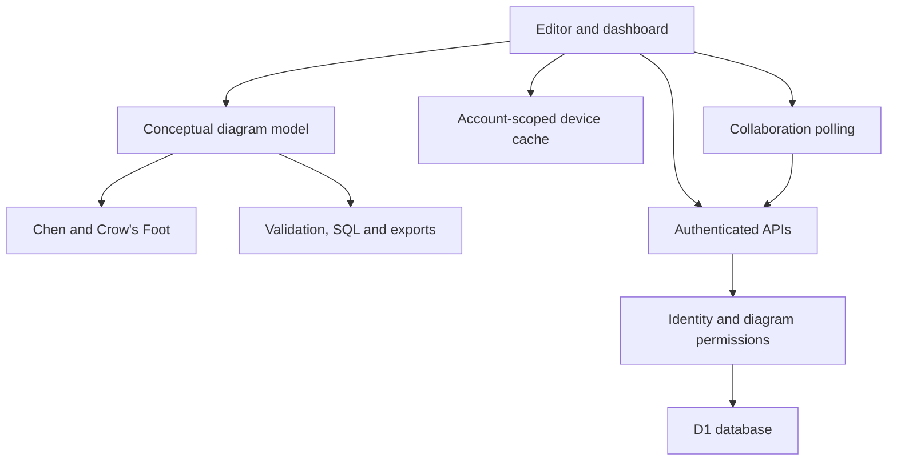

# Architecture

## Request and rendering flow

The root application route redirects to `/studio/`. The editor is a set of native browser ES modules and CSS files, rather than a React canvas component. SVG provides interactive shapes, labels, lines, selection, and cursors. TypeScript route adapters forward requests to shared server functions running on a Cloudflare Worker with a D1 binding.



## Main client modules

| Module | Responsibility |
| --- | --- |
| `app.js` | Editor/dashboard state, live naming, selection, history, dialogs, account initialization, import/export and onboarding |
| `core.js` | Model validation, shape sizes/boundaries, Chen SVG, export geometry and shared helpers |
| `crowfoot.js` | Crow’s Foot cards and associations |
| `relationship-tools.js` | Participant lookup and consistent cardinality/participation updates |
| `design-tools.js`, `layout.js` | Group operations, layout, guides and validation |
| `routing.js`, `label-layout.js` | Connection routing, geometry and label placement |
| `interaction.js` | Pointer gestures, panning and zooming |
| `workspace.js`, `dashboard-tools.js` | Guest project persistence/migration and dashboard filtering/totals |
| `cloud.js`, `offline.js` | Autosave queue, revision checks, cache validation and reconnection |
| `merge.js` | Three-way comparison/merge of models and conflict detection |
| `collaboration.js` | Invitations, members, comments, presence, polling and remote updates |
| `vector-pdf.js`, `sql.js` | Vector PDF with embedded fonts; PostgreSQL generation |
| `theme.js`, `pwa.js`, `notifications.js` | Appearance, install/update lifecycle, and notifications visible above dialogs |
| `presets.js`, `icons.js` | Editable templates and interface icons |

## Model format

The persisted/exported conceptual diagram uses `version: 1`, a title, optional notation, nodes, and edges. A project envelope adds an ID, timestamps, revision and access/sync metadata.

```json
{
  "version": 1,
  "title": "Customer orders",
  "notation": "chen",
  "nodes": [
    {"id": "customer", "type": "entity", "name": "Customer", "x": 200, "y": 320},
    {"id": "places", "type": "relationship", "name": "Places", "x": 450, "y": 320},
    {"id": "order", "type": "entity", "name": "Order", "x": 700, "y": 320}
  ],
  "edges": [
    {"id": "customerPlaces", "source": "customer", "target": "places", "labelSource": "1", "routing": "straight"},
    {"id": "placesOrder", "source": "places", "target": "order", "labelTarget": "N", "totalTarget": true, "routing": "straight"}
  ]
}
```

Node types are `entity`, `relationship`, and `attribute`. Flags represent weak/identifying elements, keys, derived/multivalued/composite attributes, and SQL properties. Validation normalizes supported fields and rejects invalid IDs, dangling references, invalid names/positions, oversized graphs, and unsupported model versions.

A model can contain up to **500 nodes** and **2,000 edges**. IDs are unique, bounded strings. Node coordinates are bounded to ±100,000. Labels and title lengths are bounded. Request byte limits provide another guard on server-side input.

Cardinality is taken from the entity endpoint of an entity–relationship edge: `labelSource` when its source is the entity, or `labelTarget` when its target is the entity. Total participation uses the participant’s corresponding total flag; legacy whole-connection total values remain readable. Updating participant settings clears obsolete opposite-side duplicate values.

Crow’s Foot, SQL generation, validation, sharing and exports consume these same participant values. There is no second independent model to reconcile after switching notation.

## Saving, versions and merging

Guests save project envelopes to device storage. Account initialization resolves identity before exposing cloud records. Signed-in users use account-specific caches and optimistic revisions.

Every server edit verifies the account and diagram role. A compatible three-way merge compares a verified historical baseline, the submitted model, and the current saved model. If concurrent edits conflict on the same field, the original local work is preserved and recovery copies remain available. The API rechecks permissions on contested writes.

Deleting soft-deletes a diagram. Immediate Undo restores the local project and queues a corresponding owned save. History is retained separately, capped at 50 versions per diagram. Restoration writes a new revision rather than rewriting old history.

## Collaborative editing

The active, visible editor polls team/presence information and diagram revisions approximately every two seconds. A changed model is received only when the local editor can safely accept it. Presence is transient; comments and membership persist in D1. There are no WebSockets, distributed CRDTs, or background delivery guarantees in this implementation.

## Rendering and export

Connections are rendered before nodes, so shape fills cover lines behind them. Chen layout packs entity/attribute clusters and places relationships around connected entities. Branching diagrams distribute connections across directions; relationship attributes can occupy any of four sides. General packing handles large/deep clusters. Layout is deterministic and stored as editable node positions.

SVG export includes all model bounds. PNG rasterizes the exported SVG at a bounded resolution. PDF walks vector elements and text, embeds local regular/bold fonts, and lays the diagram onto one page or bounded tiled pages. Export colors are chosen independently of the UI theme.

## Offline and updates

`public/sw.js` precaches an explicit editor shell, including local export libraries and fonts. APIs, authentication and shared-viewer requests bypass this cache. An already cached account can edit offline, but reconnection verifies that the live account matches before writes resume.

New shell versions wait for user activation. Reload permission considers save failures and pending cloud work. Installed-app detection hides the install button after installation. This is browser/PWA behavior, not an Android or Windows native installer.

## Host trust boundary

Sites supplies authenticated user headers through its trusted gateway. Those headers are **not bearer credentials** and must not be accepted directly from the public internet when hosting elsewhere. Google sessions are resolved from verified, hashed server-side tokens. See [deployment](DEPLOYMENT.md) and [security](../SECURITY.md).
